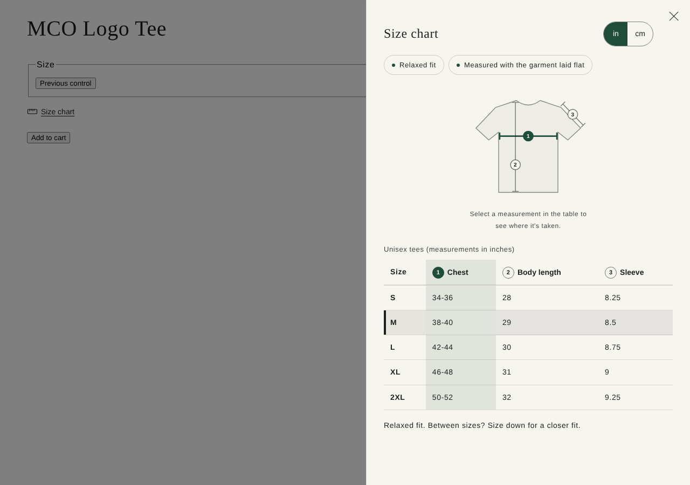
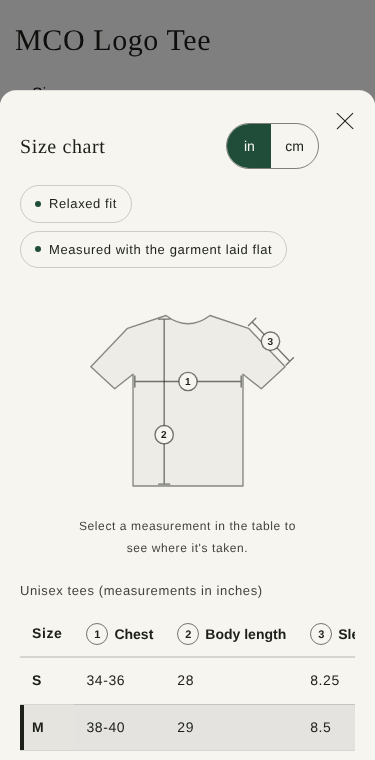
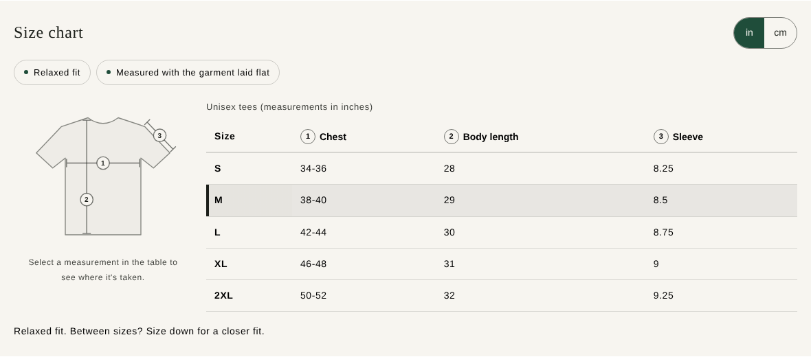

# MCO Size Chart Theme

A full Shopify theme based on [Dawn](https://github.com/Shopify/dawn) v16.1.1, with a calm editorial look, a reusable **size chart and fit guide** driven by metaobjects, and **size chart events sent to GA4 through Google Tag Manager**.

Built by Melvin Carmona Ortiz ([MCO WebLab](https://mcoweblab.com)) with Claude Code, for a Shopify development store.



## What it does

- **One chart, many products.** Size charts are `size_chart` metaobjects. Each product points to one through the `custom.size_chart` metafield, so 40 T-shirts can share a single "Unisex tees" chart. A fallback chart can be picked in the theme editor for products without their own.
- **Fit guide drawing.** A T-shirt, pants or shoe drawing with numbered measurement lines. Hover a column to preview its line, or press the numbered header to pin it (works on touch screens and with the keyboard). Columns are matched by name in English or Spanish (Chest/Pecho, Sleeve/Manga...).
- **Drawer or bottom sheet.** On desktop the chart slides in from the side so the product stays visible; on phones it's a bottom sheet. A centered pop-up is also available.
- **Theme editor settings.** Pop-up or on-page display, pop-up style, which drawing, heading, which unit shows first, the inches/centimeters switch, "fit fact" labels, "how to measure" tips and a color scheme. Merchants change these without code.
- **Editorial look.** Fraunces headings and Instrument Sans text from Shopify's font library, an off-white and deep green palette with at least 8.8:1 text contrast, and motion that switches off for visitors who prefer reduced motion.
- **Inches and centimeters.** The switch converts every measurement, including ranges like `34-36`, and always converts from the original value so switching back and forth never drifts.
- **Knows the selected size.** When the shopper picks a size (option named `Size` or `Talla`, configurable), the matching row is highlighted.
- **Bilingual.** Storefront text in English and Spanish (`locales/`).
- **Analytics.** Three events go to `window.dataLayer` for Google Tag Manager and to `Shopify.analytics.publish` for Shopify Custom Pixels:

| Event | When | Main parameters |
|---|---|---|
| `size_chart_open` | Pop-up opened, or on-page chart scrolled into view (once) | `product_id`, `chart_name`, `unit`, `open_trigger` |
| `size_chart_unit_change` | Shopper switches inches/centimeters | `unit` |
| `size_select` | Shopper picks a different size | `size`, `variant_id`, `size_in_chart`, `chart_viewed` |

`chart_viewed` answers a useful question: did shoppers who picked a size look at the chart first?

## Files added or changed

| File | What it is |
|---|---|
| `sections/size-chart.liquid` | The section, its settings (``) and the data lookup |
| `snippets/size-chart-table.liquid` | Renders the table from the chart's JSON and matches columns to measurements |
| `snippets/size-chart-diagram.liquid` | The fit guide drawings (inline SVG) |
| `snippets/size-chart-trigger.liquid` | The "Size chart" button |
| `assets/size-chart.js` | `<size-chart>` custom element, unit conversion, events |
| `assets/component-size-chart.css` | Styles, using Dawn's color scheme variables |
| `snippets/google-tag-manager.liquid` | Loads GTM from Theme settings; skipped in the theme editor |
| `sections/main-product.liquid` | New "Size chart button" block (small change to a Dawn file) |
| `templates/product.json` | Adds the button and the section (drawer, T-shirt drawing, two fit facts) to the default product page |
| `templates/index.json` | Demo home page: hero, "How our sizing works", New arrivals |
| `config/settings_data.json` | Fonts, colors, button shape and spacing |
| `config/settings_schema.json` | New "Google Tag Manager" settings group |
| `layout/theme.liquid` | Two lines that render the GTM snippet |
| `locales/en.default.json`, `locales/es.json` | Storefront text |

<p>
  
  
</p>

## Setup

1. [Metafield and metaobject definitions](docs/metafields.md) (about 10 minutes in the Shopify admin).
2. Run the theme: `shopify theme dev --store your-store` (needs [Shopify CLI](https://shopify.dev/docs/storefronts/themes/tools/cli)).
3. [Google Tag Manager and GA4 setup](docs/gtm-ga4.md).

How the pieces fit together: [docs/how-it-works.md](docs/how-it-works.md).

## Tests

```bash
npm install
npm test                       # unit and Liquid render tests (42)
npx playwright install chromium   # first time only
npm run test:browser           # browser tests in headless Chromium (21)
npm run theme-check            # Shopify Theme Check
```

- **Liquid render tests** run the real section and snippets through [LiquidJS](https://liquidjs.com) with stand-ins for Shopify-only filters. LiquidJS is close to Shopify's Liquid but not identical, so the development store is still the final check.
- **Browser tests** load the real CSS and JS, plus Dawn's own `pubsub.js`, and check the pop-up, drawer and bottom sheet, the fit guide, keyboard use, events, reduced motion, 320px and 375px phone widths and [axe](https://github.com/dequelabs/axe-core) results. They use fallback system fonts, because the test machine can't download Shopify's fonts.
- **Theme Check** reports the same 9 warnings as unmodified Dawn v16.1.1 and nothing from the new files.

GitHub Actions runs all of this on every push (`.github/workflows/ci.yml`).

## Status

- [ ] Tested on a Shopify development store
- [ ] Events checked in GTM Preview and GA4 DebugView

Automated tests pass. Results on a real store will be recorded here once checked.

## Known limits

- GTM loads from the theme, so it only runs on storefront pages. Checkout and thank-you pages need a Shopify Custom Pixel.
- GTM loads without asking for consent. A store that needs a cookie banner (for example for EU shoppers) should connect it to Shopify's Customer Privacy API and Google Consent Mode first.
- Column headers come from the chart's JSON, so a Spanish store translates them with Shopify's Translate & Adapt app.
- The pop-up needs JavaScript. The on-page display works without it, in the chart's original unit.

## License

Dawn is © Shopify Inc. and used under the terms in [LICENSE.md](LICENSE.md), which allow its use for themes that work with Shopify.
